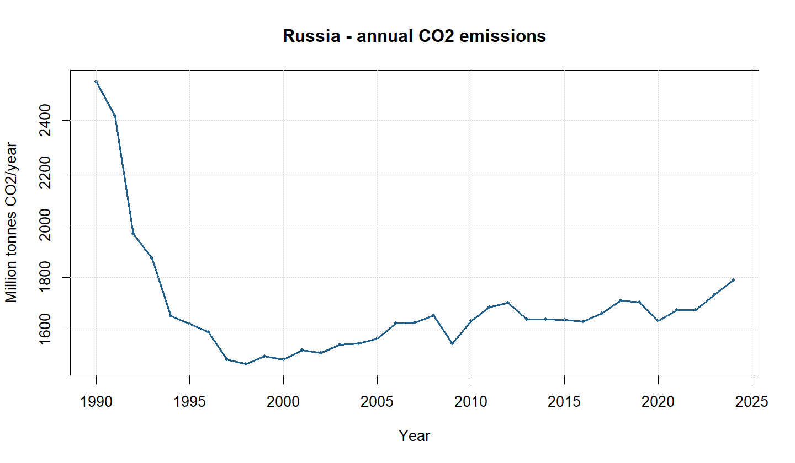
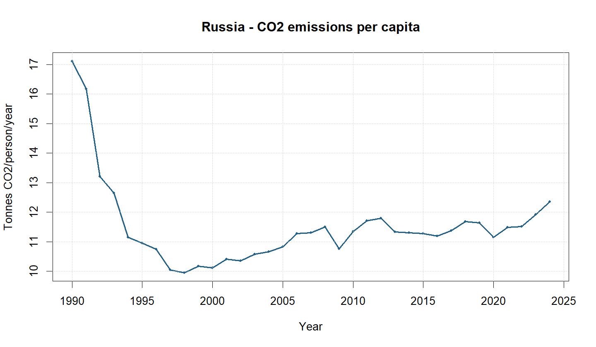
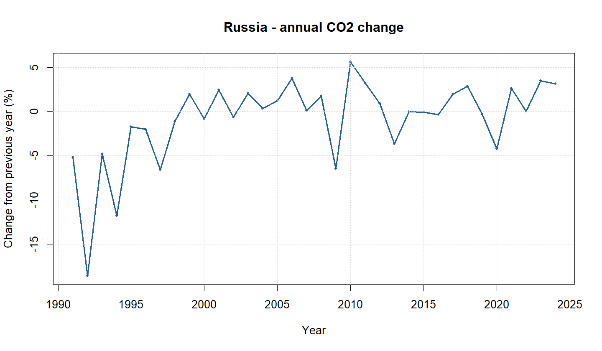

# CO2 Emissions Analysis: Russia (1990–2024)

**Student:** Brent B. Al-os 

**Country / ISO-3:** Russia / RUS  
**Study period:** 1990 to 2024  

## Research Question

How have Russia's annual CO2 emissions and per-capita emissions changed from 1990 to 2024?

## Data Source and Definitions

The dataset was obtained from Our World in Data (OWID), CO2 and Greenhouse Gas Emissions dataset.

- **Official dataset:** https://github.com/owid/co2-data
- **CSV download:** https://owid-public.owid.io/data/co2/owid-co2-data.csv
- **Downloaded on:** November 14, 2026
- **Selected columns:** country, iso_code, year, co2, co2_per_capita

The `co2` column represents annual CO2 emissions from fossil fuels and industrial processes, measured in million tonnes per year, excluding land-use change.

The `co2_per_capita` column represents annual CO2 emissions per person, measured in tonnes per person per year.

## How to Reproduce the Analysis

1. Install R, RStudio, and Git.
2. Clone this repository and open it as an RStudio Project.
3. Ensure an internet connection is available for the first dataset download.
4. Open the RStudio Console and run:

```r
source("scripts/analyze_co2.R")
```

5. Inspect the generated files in the `data/`, `figures/`, and `results/` folders.

The analysis uses base R and does not require additional R packages.

## Results

The analysis covers 35 years of Russia's CO2 emissions data, from 1990 to 2024.

- **Earliest valid year:** 1990
- **Latest valid year:** 2024
- **Annual CO2 emissions in 1990:** 2,548.71 million tonnes
- **Annual CO2 emissions in 2024:** 1,788.47 million tonnes
- **Overall percentage change:** −29.83%
- **Peak emissions year:** 1990
- **Peak annual emissions:** 2,548.71 million tonnes
- **CO2 emissions per capita in 1990:** 17.11 tonnes/person
- **CO2 emissions per capita in 2024:** 12.35 tonnes/person
- **Largest annual decrease:** 1992 (−18.61%)
- **Largest annual increase:** 2010 (+5.60%)

### Figure 1. Annual CO2 Emissions in Russia



### Figure 2. CO2 Emissions Per Capita in Russia



### Figure 3. Annual Percentage Change in Russia's CO2 Emissions



## Interpretation (200–300 Words)

Based on the Our World in Data (OWID) dataset, Russia's annual carbon dioxide (CO2) emissions showed an overall decrease from 1990 to 2024. In 1990, Russia emitted 2,548.71 million tonnes of CO2, compared with 1,788.47 million tonnes in 2024. This represents a 29.83% decrease. The highest emissions occurred in 1990, with 2,548.71 million tonnes.

A sustained decline was observed during the 1990s. The largest annual decrease occurred in 1992, when emissions fell by 18.61% compared with 1991. The International Monetary Fund (1999) reported that Russia experienced major economic difficulties and changes in production during its transition to a market economy. These conditions may help explain the decrease in emissions, although this analysis cannot prove the exact cause.

Emissions later increased during several years. The largest annual increase occurred in 2010, reaching 5.60%. This shows that Russia's emissions did not decrease continuously throughout the study period.

Total CO2 emissions represent the amount released by the country, while per-capita emissions represent the average amount per person. Russia's per-capita emissions decreased from 17.11 tonnes in 1990 to 12.35 tonnes in 2024.

These patterns are important because CO2 contributes to global warming, which can affect ecosystems, biodiversity, and environmental conditions. However, the dataset mainly measures territorial emissions from fossil fuels and industrial processes. It excludes land-use change and does not fully represent emissions associated with imported goods. Therefore, the results describe national emission patterns but cannot explain every factor affecting climate change.

## Limitations

This analysis uses country-level territorial CO2 emissions, which do not include emissions associated with imported goods. The dataset also excludes emissions from land-use change and does not represent all greenhouse gases.

The analysis is descriptive and cannot determine the exact causes of changes in emissions. Economic conditions, energy use, and government policies may influence emissions, but additional information is needed to examine these relationships.

## References

International Monetary Fund. (1999). *Russia: Recent Economic Developments*. IMF Staff Country Report. https://www.imf.org/

Our World in Data. (n.d.). *CO2 and Greenhouse Gas Emissions*. https://github.com/owid/co2-data

Our World in Data. (n.d.). *CO2 emissions dataset (CSV)*. https://owid-public.owid.io/data/co2/owid-co2-data.csv

